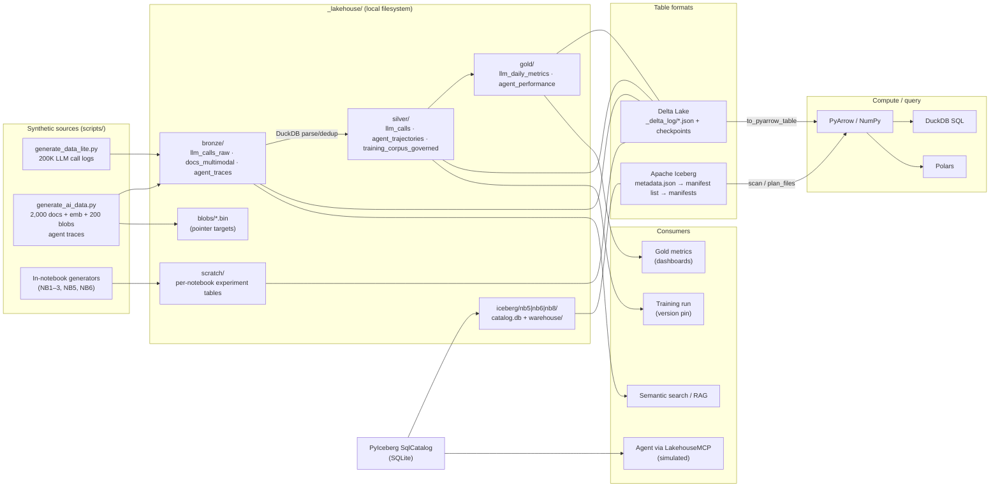
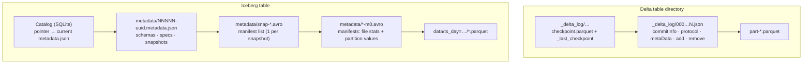

# 02 — Architecture of the Lab

[← README](README.md) · Prev: [01 — Overview](01-lakehouse-overview.md) · Next: [03 — Data flow](03-data-flow.md)

✅ **Implemented in this lab** (lightweight path). The Spark path is 📘 context only — see [spark-minio-docker](technologies/spark-minio-docker.md).

## Component diagram (actual implementation)



## Components

| Component | Technology | Role | Why it exists |
|---|---|---|---|
| Storage | Local disk under `_lakehouse/` (root overridable via `LAKEHOUSE_ROOT`) | Holds every file of every table | Lightweight, offline; same layout an object store would hold |
| File format | Parquet (snappy; delta-rs OPTIMIZE wrote zstd) | Columnar data files with footer stats | Column pruning, compression, per-file min/max |
| Table format A | Delta Lake via `deltalake` 1.6.6 | ACID log, versions, MERGE/DELETE, OPTIMIZE, VACUUM, CDF | Turns Parquet folders into tables (NB1–4, 6–8) |
| Table format B | Apache Iceberg via `pyiceberg` 0.12.0 | Snapshots, hidden partitioning, field-IDs, spec evolution | Second format; catalog-centric design (NB5, 6, 8) |
| Catalog | `SqlCatalog` on SQLite, **one per notebook** (`nb5`, `nb6`, `nb8`) | Registers tables, owns location + current-metadata pointer | Catalog = control plane; isolation avoids cross-notebook resets |
| SQL engine | DuckDB 1.5.6 | JSON parsing, dedup, quantiles, joins, `array_cosine_similarity` | In-process SQL over Arrow, no server, no extension download |
| DataFrames | Polars 1.44.2 | Build/print frames, row hashing | Fast, Arrow-native |
| Interchange | Apache Arrow (pyarrow 25.0.1) | Zero-copy hand-off Delta/Iceberg ↔ DuckDB/Polars | Avoids DuckDB `delta_scan()` network extension |
| Helpers | `scripts/lakehouse.py` | `path()`, `reset()`, `catalog()`, `reset_catalog()`, `du()`, `count_files()`, `to_arrow()` | Consistent paths + idempotent reruns |
| Agent surface | `LakehouseMCP` class (NB8) | Cached list, confirmation, tasks, per-tool metering | Models the agent ↔ catalog boundary (simulation, not a server) |
| Notebooks | Jupyter Lab + Jupytext | `.py` percent files → `.ipynb` | Reviewable diffs |
| Validation | `verify_lite.py` (9 checks), `pytest` (24 tests), `run_all.py` | Smoke, invariants/canaries, end-to-end | Reproducibility gate |

## Storage layout on disk (as created)

```text
_lakehouse/
├── bronze/   llm_calls_raw/ · docs_multimodal/ · agent_traces/        (Delta)
├── silver/   llm_calls/date=…/ · agent_trajectories/agent_version=…/ ·
│             training_corpus_governed/provenance_bucket=…/            (Delta, partitioned)
├── gold/     llm_daily_metrics/date=…/ · agent_performance/            (Delta)
├── scratch/  users_delta · events_smallfiles · customers_tt · maint_events ·
│             media_inline · media_pointer · emb_f32 · emb_int8 · docs_cdf · …
├── blobs/    *.bin   (200 × 64 KB media frames)
└── iceberg/  nb5/ · nb6/ · nb8/   → catalog.db + warehouse/lake/<table>/{data,metadata}
```

## Delta vs Iceberg internals (side by side)



Read more: [transaction-log-and-acid](concepts/transaction-log-and-acid.md) · [catalog-and-metadata](concepts/catalog-and-metadata.md)

## Key Takeaways

- Everything is files on disk; the **table format** and **catalog** are what make them tables.
- Engines are interchangeable because they meet at **Arrow** and **Parquet**.
- Each notebook owns its catalog and scratch tables → reruns are idempotent and isolated.
