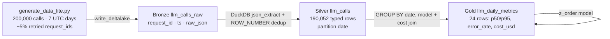
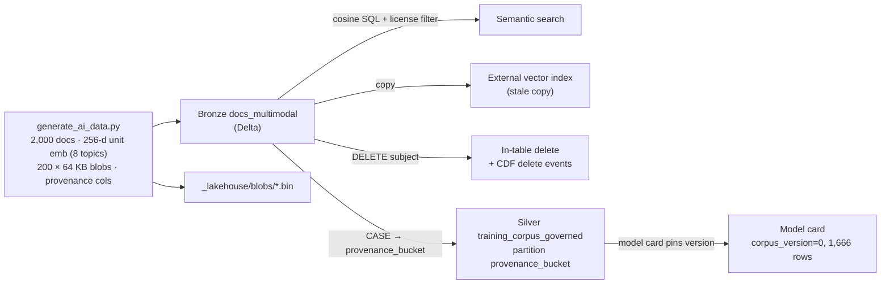
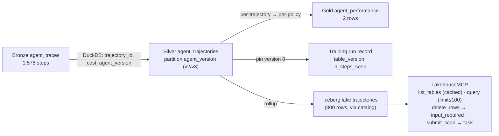

# 03 — End-to-End Data Flow

[← README](README.md) · Prev: [02 — Architecture](02-architecture.md) · Next: [04 — Mapping](04-lab-to-lakehouse-mapping.md)

✅ **Implemented in this lab.** Three real flows: **LLM observability** (NB4), **AI corpus** (NB7–8), **agent trajectories** (NB8). Experiments in NB1–3, 5, 6 use scratch tables.

## Flow 1 — LLM observability (NB4)

| Step | What happens | Why | Tech | In → Out | Concept |
|---|---|---|---|---|---|
| Ingest | Synthetic calls written raw, JSON payload as string | Keep source truth for reprocessing | Polars + `write_deltalake` | — → 200,000 rows | [Bronze](concepts/medallion-architecture.md) |
| Parse + type | `json_extract`, `CAST` to INTEGER, `CAST(ts AS DATE)` | Schema for analytics | DuckDB | JSON string → 9 typed cols | [Silver](concepts/medallion-architecture.md) |
| Dedup | `ROW_NUMBER() OVER (PARTITION BY request_id ORDER BY ts)`, keep `rn=1` | Retries duplicate events (9,687 ids, up to 4 attempts) | DuckDB | 200,000 → 190,052 | Data quality |
| Partition | `partition_by=["date"]` | Prune by date | delta-rs | — | [Partitioning](concepts/partitioning.md) |
| Aggregate | p50/p95 (`QUANTILE_CONT`), error_rate, illustrative cost | Answer business questions | DuckDB | 190,052 → 24 rows | [Gold](concepts/medallion-architecture.md) |
| Optimize | `z_order(["model"])` | Demo (3 rows/partition → no real gain) | delta-rs | 8 → 8 files | [Data skipping](concepts/file-layout-and-data-skipping.md) |

⚠️ Gold showed **8 dates**, not 7: `CAST(ts AS DATE)` used DuckDB session time zone `Asia/Bangkok`. → [troubleshooting](techniques/troubleshooting.md#timezone-dependent-date-partitions)

## Flow 2 — AI corpus: docs, blobs, embeddings, provenance (NB7, NB8)

| Step | What happens | Tech | Result | Concept |
|---|---|---|---|---|
| Layout test | Same 200 blobs stored inline (`binary`) vs pointer (`blob_uri`) | delta-rs, Parquet footer | Scan reads 1.2 KB either way; random read 200× amplified inline | [Vectors & multimodal](concepts/vectors-and-multimodal-data.md) |
| Quantize | float32 → int8 (`round(x·127)`) | NumPy, delta-rs | 2.6 MB → 451.9 KB (5.8×); recall@10 0.904 | same |
| Search | `array_cosine_similarity(emb::FLOAT[256], q::FLOAT[256])` + governance filter | DuckDB | Top-5 same topic; doc 7 excluded (license unknown) | same |
| Erasure | `dt.delete("subject_id = 'user_042'")` | delta-rs | Table 0 hits, external copy 8 hits; v0 still 8 | [Lifecycle & erasure](concepts/data-lifecycle-and-erasure.md) |
| Propagate | `load_cdf(starting_version=1)` | delta-rs CDF | 8 `delete` events | same |
| Classify | `CASE license … END AS provenance_bucket` | DuckDB | 4 buckets + 334 UNCLASSIFIED | [Provenance](concepts/provenance-and-reproducibility.md) |

## Flow 3 — Agent trajectories (NB8)

| Step | Result | Concept |
|---|---|---|
| Silver partitioned by `agent_version` | 2 partitions | [Partitioning](concepts/partitioning.md) |
| Gold per policy | success 0.760 vs 0.753 (synthetic split — no real difference) | [Medallion](concepts/medallion-architecture.md) |
| Pin + replay | v0 = 1,578 steps; later v1 = 1,978 (400 duplicate rows) | [Reproducibility](concepts/provenance-and-reproducibility.md) |
| Agent access | 5 turns → 1 catalog read; destructive call → `input_required` | [Agent data access](concepts/agent-data-access.md) |

## Key Takeaways

- Data only moves **forward** (Bronze → Silver → Gold); every layer is a versioned Delta table.
- Engines hand data to each other as **Arrow tables**, not via files or network services.
- AI flows add two obligations ordinary BI flows don't: **lifecycle propagation** and **provenance/version pinning**.
