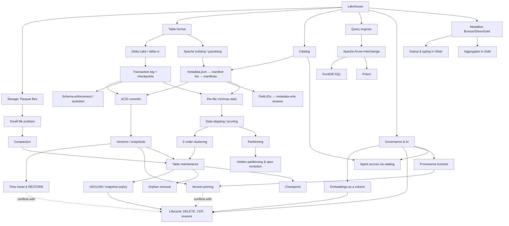

# 05 — Knowledge Map

[← README](README.md) · Prev: [04 — Mapping](04-lab-to-lakehouse-mapping.md)

How the concepts and technologies of this lab connect. Click-through links are in the tables below the diagram.

## Where each node is documented

| Node(s) | Page |
|---|---|
| Transaction log, ACID, checkpoints | [concepts/transaction-log-and-acid.md](concepts/transaction-log-and-acid.md) |
| Schema enforcement/evolution, field-IDs | [concepts/schema-enforcement-and-evolution.md](concepts/schema-enforcement-and-evolution.md) |
| Versions, time travel, RESTORE | [concepts/time-travel-and-versioning.md](concepts/time-travel-and-versioning.md) |
| Stats, skipping, small files, compaction, Z-order | [concepts/file-layout-and-data-skipping.md](concepts/file-layout-and-data-skipping.md) |
| Partitioning, hidden partitioning, spec evolution | [concepts/partitioning.md](concepts/partitioning.md) |
| Catalog, metadata tree | [concepts/catalog-and-metadata.md](concepts/catalog-and-metadata.md) |
| Maintenance: vacuum, expiry, orphans, checkpoint | [concepts/table-maintenance.md](concepts/table-maintenance.md) |
| Medallion, dedup, aggregates | [concepts/medallion-architecture.md](concepts/medallion-architecture.md) |
| Embeddings, blobs | [concepts/vectors-and-multimodal-data.md](concepts/vectors-and-multimodal-data.md) |
| Lifecycle, CDF, erasure | [concepts/data-lifecycle-and-erasure.md](concepts/data-lifecycle-and-erasure.md) |
| Provenance, version pinning | [concepts/provenance-and-reproducibility.md](concepts/provenance-and-reproducibility.md) |
| Agent access | [concepts/agent-data-access.md](concepts/agent-data-access.md) |
| Delta, Iceberg, DuckDB, Polars, Arrow/Parquet | [technologies/](technologies/) |

## The three tensions worth remembering

| Tension | Sides | Resolved by |
|---|---|---|
| History vs storage cost | Time travel needs old files ↔ old files cost money | Retention window + VACUUM/expiry |
| Reproducibility vs erasure | Pinned versions must stay readable ↔ deleted subjects must disappear | Retention policy, documenting erasures in model cards, retraining |
| Few big files vs prunable files | Compaction wants few files ↔ skipping needs many narrow files | `target_size` + clustering on filter columns |
